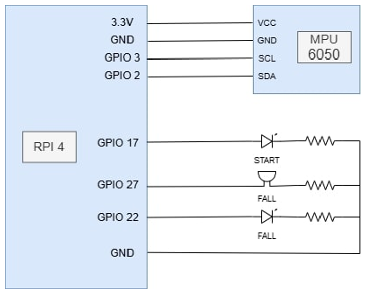
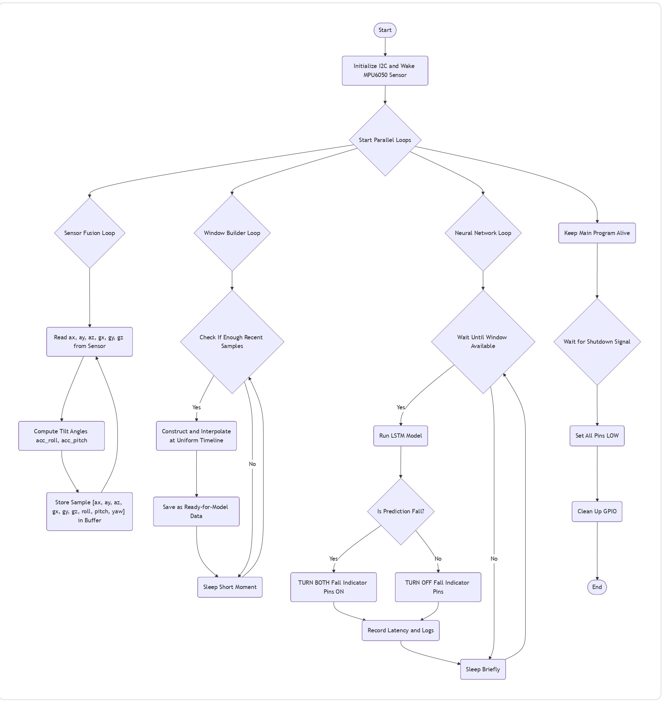

# Elderly Fall Detection System – AI/ML on Raspberry Pi

**A real-time fall detection system that runs a deep learning model (CNN + LSTM) on a Raspberry Pi 4. An MPU-6050 accelerometer and gyroscope tracks body movement, and when a fall is detected the system raises a local alarm with a buzzer and LED, without the person needing to press any button.**

<p align="center">
  
  
  
  
  
  
</p>

---

## Table of Contents

1. [Project Overview](#1-project-overview)
2. [Objectives](#2-objectives)
3. [Hardware Components and Circuit](#3-hardware-components-and-circuit)
4. [Tools and Technologies](#4-tools-and-technologies)
5. [Dataset](#5-dataset)
6. [Data Preparation](#6-data-preparation)
7. [Model Architecture](#7-model-architecture)
8. [Training and Results](#8-training-and-results)
9. [Model Optimization for the Edge](#9-model-optimization-for-the-edge)
10. [Real-Time Detection Pipeline](#10-real-time-detection-pipeline)
11. [Deployment Versions](#11-deployment-versions)
12. [Project Structure](#12-project-structure)
13. [How to Run the Project](#13-how-to-run-the-project)
14. [Limitations and Future Improvements](#14-limitations-and-future-improvements)
15. [Team](#15-team)

---

## 1. Project Overview

More and more elderly people live independently, and falling is one of the biggest risks they face. Existing **personal emergency response systems (PERS)** usually need the person to press a button to call for help. After a serious fall, the person may be unconscious, confused, or unable to move (for example, after a hip fracture or stroke), so a manual button does not help.

This project builds an **autonomous fall detection system** that needs no action from the user:

1. An **MPU-6050** sensor continuously measures acceleration and rotation.
2. A **Raspberry Pi 4** combines the sensor readings and builds a rolling window of the most recent motion.
3. A **Conv1D + LSTM neural network**, converted to **TensorFlow Lite**, classifies each window as **Fall** or **Not Fall**.
4. When a fall is detected, the Pi switches on a **buzzer** and a **red LED**.

The model was trained on the public **KFall dataset**, which contains 5,075 motion recordings of 21 daily activities and 15 types of falls.

**Main result:** the converted TensorFlow Lite model reached **94.35% accuracy** on the validation set, with **95.7% precision** and **82.4% recall** for falls (see [Training and Results](#8-training-and-results)).

## 2. Objectives

The main objectives are to:

- Detect falls automatically, without the user pressing a button.
- Distinguish real falls from normal daily activities such as walking, sitting down and climbing stairs.
- Train a lightweight deep learning model on a large public fall dataset.
- Optimize the model so that it runs in real time on a Raspberry Pi.
- Build a low-cost prototype from readily available hardware and open-source tools.
- Raise an immediate local alert (buzzer + LED) when a fall is detected.

## 3. Hardware Components and Circuit

### Components

| Component | Purpose |
|---|---|
| Raspberry Pi 4 | Runs sensor reading, data processing and model inference |
| MPU-6050 | 6-axis inertial sensor (3-axis accelerometer + 3-axis gyroscope), connected over I²C |
| LEDs | "Start" indicator and "Fall" indicator |
| Buzzer | Audible fall alarm |
| 220 Ω resistors | Current limiting for the LEDs and buzzer |
| Breadboard and jumper wires | Connections |

### Wiring

| Raspberry Pi 4 pin | Connected to | Role |
|---|---|---|
| 3.3V | MPU-6050 VCC | Sensor power |
| GND | MPU-6050 GND | Ground |
| GPIO 2 (SDA) | MPU-6050 SDA | I²C data |
| GPIO 3 (SCL) | MPU-6050 SCL | I²C clock |
| GPIO 17 | Start LED (through 220 Ω) | Turns on when the program starts |
| GPIO 27 | Buzzer (through 220 Ω) | Sounds when a fall is detected |
| GPIO 22 | Fall LED (through 220 Ω) | Lights up when a fall is detected |
| GND | LED / buzzer common ground | Ground |



## 4. Tools and Technologies

| Category | Tools |
|---|---|
| Programming Language | Python |
| Deep Learning | TensorFlow, Keras |
| Edge Deployment | TensorFlow Lite |
| Data Processing | NumPy, Pandas, SciPy |
| Machine Learning Utilities | Scikit-Learn |
| Visualization | Matplotlib, Seaborn, PyQtGraph |
| Desktop GUI | PyQt5 |
| Hardware Interface | smbus (I²C), RPi.GPIO |
| Hardware | Raspberry Pi 4, MPU-6050 |
| Development Environment | Jupyter Notebook, Google Colab |
| Version Control | Git, GitHub |

## 5. Dataset

**Dataset:** KFall – A Large-Scale Open Motion Dataset for Fall Detection

**Source:** [KFall dataset website](https://sites.google.com/view/kfalldataset) · [Research paper (Yu et al., 2021)](https://doi.org/10.3389/fnagi.2021.692865)

| Dataset Attribute | Details |
|---|---|
| Participants | 32 subjects (SA06–SA38) |
| Sensor | 9-axis inertial sensor attached to the lower back |
| Sampling rate | 100 Hz |
| Activities of daily living (ADLs) | 21 types (Task IDs 1–19, 35, 36) |
| Fall types | 15 types (Task IDs 20–34) |
| Motion files | 5,075 |
| Signals per sample | 3-axis acceleration, 3-axis angular velocity, 3-axis Euler angles |
| Fall labels | Frame of fall onset and frame of impact for every fall trial |

### Fall types in the dataset

| Code | Description |
|---|---|
| F01 – F03 | Forward, backward and lateral falls when trying to sit down |
| F04 – F05 | Forward and lateral falls when trying to get up |
| F06 – F08 | Forward, backward and lateral falls while sitting, caused by fainting |
| F09 – F10 | Falls while walking caused by fainting (including using hands on a table to dampen the fall) |
| F11 – F12 | Forward falls while walking or jogging caused by a trip |
| F13 – F15 | Forward, forward-lateral and backward falls while walking caused by a slip |

### File naming

Each motion file is named `S<subject>T<task>R<trial>.csv`. For example, `S06T21R04.csv` is Subject 06, Task 21 (backward fall when trying to sit down), Trial 4.

**Note:** the dataset (about 490 MB) is not included in this repository. Download it from the KFall website and place it as shown in the [Project Structure](#12-project-structure).

## 6. Data Preparation

### 6.1 Window extraction

The model looks at **windows of 50 consecutive samples**, which is **0.5 seconds** of motion at 100 Hz. Each sample has 9 values (3 acceleration + 3 gyroscope + 3 orientation), so every window has the shape **(50, 9)**.

| Class | How windows are extracted |
|---|---|
| **Fall (1)** | For each fall trial, one 50-sample window is taken from the middle of the period between **fall onset** and **impact**, using the dataset's labels. Trials where this period is shorter than 50 samples are skipped. |
| **Not Fall (0)** | For each ADL recording, non-overlapping 50-sample windows are taken: up to 10 windows for long continuous activities (Task IDs 1, 11, 12 and 17) and up to 2 windows for the other activities. Recordings shorter than 100 samples are skipped. |

### 6.2 Final dataset

| Attribute | Value |
|---|---:|
| Total windows | 8,732 |
| Fall windows | ~2,250 (≈26%) |
| Not-fall windows | ~6,480 (≈74%) |
| Window shape | 50 time steps × 9 features |

### 6.3 Preprocessing

- **Labels** are one-hot encoded (`[1, 0]` = Not Fall, `[0, 1]` = Fall).
- **Split:** 70% training, 15% validation, 15% test, using a random split.
- **Normalization:** each of the 9 features is min-max scaled to the range **[-1, 1]**.

| Split | Windows |
|---|---:|
| Training | 6,112 |
| Validation | 1,310 |
| Test | 1,310 |

## 7. Model Architecture

The model combines **1D convolutions**, which detect short local motion patterns such as sudden spikes in acceleration, with **LSTM layers**, which learn how the motion changes over time across the window.

```text
Input (50 × 9)
   │
   ├─ Conv1D (16 filters, kernel 2) → LayerNorm → Dropout (0.1)
   ├─ Conv1D (64 filters, kernel 2) → LayerNorm → MaxPool (2)
   ├─ Conv1D (128 filters, kernel 2) → LayerNorm → MaxPool (2)
   ├─ Conv1D (64 filters, kernel 2) → LayerNorm → MaxPool (2)
   │
   ├─ LSTM (32 units, return sequences) → Dropout (0.3)
   ├─ LSTM (32 units) → Dropout (0.3)
   │
   ├─ Dense (32)
   └─ Dense (2, softmax) → [P(Not Fall), P(Fall)]
```

| Property | Value |
|---|---|
| Total parameters | **57,778** |
| Input | 50 × 9 window |
| Output | 2 classes (softmax) |
| Normalization | Layer Normalization after every convolution |
| Regularization | Dropout (0.1 after the first convolution, 0.3 after each LSTM) |

The layer sizes were deliberately kept small to reduce memory use and inference time on the Raspberry Pi.

## 8. Training and Results

### Training configuration

| Setting | Value |
|---|---|
| Loss function | Categorical cross-entropy |
| Optimizer | Adam |
| Epochs | 10 |
| Batch size | 200 |

### Training progress

| Epoch | Training Accuracy | Validation Accuracy |
|---:|---:|---:|
| 1 | – | 77.3% |
| 2 | 87.7% | 88.2% |
| 4 | 96.4% | 94.4% |
| 6 | 97.9% | 93.7% |
| 8 | 98.6% | 96.3% |
| 10 | 98.9% | 94.4% |

### Final model performance (validation set, 1,310 windows)

| Metric | Result |
|---|---:|
| Accuracy | **94.35%** |
| Precision (Fall) | 95.7% |
| Recall / Sensitivity (Fall) | 82.4% |
| Specificity (Not Fall) | 98.7% |
| F1-score (Fall) | 88.5% |

### Confusion matrix

| Actual / Predicted | Not Fall | Fall |
|---|---:|---:|
| **Not Fall** | 950 | 13 |
| **Fall** | 61 | 286 |

**Key insight:** the model rarely raises a false alarm (only 13 of 963 normal-activity windows were classified as falls). However, it missed 61 of 347 fall windows. For a safety system, missing a fall is more serious than a false alarm, so improving fall recall is the most important next step (see [Limitations](#14-limitations-and-future-improvements)).

## 9. Model Optimization for the Edge

The trained Keras model was converted to **TensorFlow Lite** in `minimize.ipynb` so that it can run efficiently on the Raspberry Pi.

| Model format | File | Size |
|---|---|---:|
| Keras (HDF5) | `conv_lstm_model.h5` | 796 KB |
| TensorFlow Lite | `conv_lstm_model.tflite` | **266 KB** (≈ 3× smaller) |

The LSTM layers need TensorFlow operations that are not in the standard TFLite set, so the conversion enables **Select TF ops** (`SELECT_TF_OPS`). `testModel.ipynb` reloads the TFLite model and confirms that it gives the same **94.35%** validation accuracy as the original Keras model.

**Note:** because of the Select TF ops, the model must be loaded with the full `tensorflow` package. The lightweight `tflite-runtime` package cannot run it.

## 10. Real-Time Detection Pipeline

On the Raspberry Pi, the system runs as **three parallel threads** that share data through queues.



### Stage 1: Sensor reading and fusion

- Reads raw acceleration (in g) and angular velocity from the MPU-6050 over I²C.
- Calculates **roll** and **pitch** using a **complementary filter** (α = 0.98). This combines the gyroscope (smooth but drifts over time) with the tilt angle from the accelerometer (noisy but does not drift).
- Calculates **yaw** by integrating the gyroscope's Z-axis.
- Stores each sample `[ax, ay, az, gx, gy, gz, roll, pitch, yaw]` in a buffer of the last 1,000 readings.

### Stage 2: Resampling

- The sensor is read as fast as possible, so the time between readings is not constant.
- The latest readings are **interpolated onto a uniform 90 Hz timeline** to build a fixed window of **50 samples**, which is the input size the model expects.

### Stage 3: Inference and alert

- Runs the TFLite model on the latest window about **90 times per second**.
- If the prediction is **Fall (1)**, GPIO 27 (buzzer) and GPIO 22 (fall LED) are switched **ON**; otherwise they are switched **OFF**.
- Records and prints the average inference latency.
- On exit (Ctrl + C), all pins are switched off and the GPIO is cleaned up safely.

## 11. Deployment Versions

The project went through three versions while it was being developed and tested.

| Folder | Data source | Description |
|---|---|---|
| `piVersion/` | **MPU-6050 sensor** (I²C) | Final Raspberry Pi version with the buzzer and LED alerts. `fallDetector.py` runs the complete system; the `stage*` files test each stage separately. |
| `modular/` | **Smartphone IMU over Wi-Fi** (UDP) | Desktop version that receives accelerometer and gyroscope data from a phone and shows live sensor plots and model predictions in a **PyQtGraph** GUI. |
| `testOnPi/` | **Simulated sensor data** | Generates random IMU data at 300 Hz to test the pipeline's speed and stability on the Pi before connecting the real sensor. |

`calculateLatency.py` is a small **UDP echo server** used to measure the network round-trip time between the phone and the computer in the smartphone version.

## 12. Project Structure

```text
Elderly_Fall_Detection_System/
│
├── main.ipynb                  # Data preparation, model training, saving
├── minimize.ipynb              # Keras → TensorFlow Lite conversion
├── testModel.ipynb             # TFLite model accuracy check
├── calculateLatency.py         # UDP echo server for network latency tests
│
├── conv_lstm_model.h5          # Trained Keras model
├── conv_lstm_model.tflite      # Optimized TFLite model
├── xval.csv, yval.csv          # Saved validation set (for testModel.ipynb)
│
├── piVersion/                  # Raspberry Pi + MPU-6050 version
│   ├── fallDetector.py         # Complete system (sensor → model → alerts)
│   ├── stage1_receiver.py      # Stage 1 only: sensor reading + fusion
│   ├── stage1and2.py           # Stages 1–2: sensor + resampling
│   ├── stage1and2and3.py       # Stages 1–3 (same as fallDetector.py, with comments)
│   ├── stage2_process.py
│   ├── stage3_applymodel.py
│   └── conv_lstm_model.tflite
│
├── modular/                    # Smartphone (UDP) version with live GUI
│   ├── stage1_receiver.py      # Receives phone IMU data + live plots
│   ├── stage2_process.py       # Resampling + live plots
│   ├── stage3_applymodel.py    # Model inference + live prediction plot
│   ├── stage3_noGUI            # Inference without the GUI
│   └── conv_lstm_model.tflite
│
├── testOnPi/                   # Simulated-sensor version for testing
│   ├── stage1_receiver.py
│   ├── stage2_process.py
│   ├── stage3_applymodel.py
│   └── conv_lstm_model.tflite
│
├── docs/
│   ├── circuit_diagram.png
│   └── system_flowchart.jpg
│
├── sensor_data_new/            # KFall sensor data (download separately)
│   ├── SA06/ ... SA38/
├── label_data_new/             # KFall fall labels (download separately)
│   ├── SA06_label.xlsx ... SA38_label.xlsx
│
└── README.md
```

## 13. How to Run the Project

### Step 1: Clone the repository

```bash
git clone https://github.com/TheAslamSyed/Elderly_Fall_Detection_System.git

cd Elderly_Fall_Detection_System
```

### Option A: Train and evaluate the model (PC or Google Colab)

**1. Install dependencies**

```bash
pip install tensorflow numpy pandas scipy scikit-learn matplotlib seaborn openpyxl jupyter
```

**2. Download the KFall dataset** from the [KFall website](https://sites.google.com/view/kfalldataset). Extract the sensor data into `sensor_data_new/` and the label files into `label_data_new/`.

**3. Run the notebooks in order:**

| Notebook | What it does | Output |
|---|---|---|
| `main.ipynb` | Extracts windows, trains the model | `conv_lstm_model.h5`, `xval.csv`, `yval.csv` |
| `minimize.ipynb` | Converts the model to TensorFlow Lite | `conv_lstm_model.tflite` |
| `testModel.ipynb` | Checks the TFLite model's accuracy | Accuracy on the validation set |

The trained models are already included, so you can skip training and go straight to deployment.

### Option B: Run on the Raspberry Pi

**1. Connect the hardware** as shown in the [circuit diagram](#3-hardware-components-and-circuit).

**2. Enable I²C** on the Raspberry Pi:

```bash
sudo raspi-config
# Interface Options → I2C → Enable, then reboot
```

Check that the MPU-6050 is detected at address `0x68`:

```bash
sudo apt install -y i2c-tools python3-smbus
i2cdetect -y 1
```

**3. Install the Python packages:**

```bash
pip install numpy tensorflow RPi.GPIO smbus
```

The full `tensorflow` package is required (see [Model Optimization](#9-model-optimization-for-the-edge)).

**4. Start fall detection:**

```bash
cd piVersion
python3 fallDetector.py
```

The **Start LED** turns on. The terminal prints sensor readings, recent predictions and the average inference latency. When a fall is detected, the **buzzer** sounds and the **Fall LED** lights up. Press **Ctrl + C** to stop; all pins are switched off safely.

### Option C: Run the smartphone version with live graphs (PC)

**1. Install the packages:**

```bash
pip install numpy tensorflow PyQt5 pyqtgraph
```

**2. Stream your phone's sensor data** to your computer's IP address on **UDP port 12345**. Use any IMU-streaming app that sends one line per reading in this format:

```text
ax,ay,az,gx,gy,gz
```

Acceleration must be in m/s² and angular velocity in rad/s. The phone and computer must be on the same Wi-Fi network.

**3. Start the GUI:**

```bash
cd modular
python stage3_applymodel.py
```

A window shows live accelerometer, gyroscope and orientation plots along with the model's predictions (0 = Not Fall, 1 = Fall) and the average inference latency.

## 14. Limitations and Future Improvements

### Current Limitations

**Model and evaluation**

- **Fall recall is 82.4%:** about 1 in 6 fall windows in the validation set was missed.
- **Random split:** windows from the same person appear in both training and validation, so accuracy on completely new people is likely to be lower. A subject-wise split would give a more realistic estimate.
- **Validation set used for reporting:** the reported results come from the validation set that was monitored during training; the separate test split was not evaluated.
- **Normalization:** each data split was scaled using its own minimum and maximum values instead of the training set's values.
- **Orientation features:** the training code reads `EulerX` into all three orientation channels, so the model never saw the Y and Z Euler angles.

**Real-time deployment**

- **Preprocessing differs between training and deployment.** The real-time scripts do not apply the [-1, 1] scaling used in training. `fallDetector.py` also converts the gyroscope to rad/s, while the KFall data is in deg/s. The model's real-world performance may therefore differ from the reported accuracy until these steps match.
- **Sampling rate:** the model was trained on 100 Hz data, but the real-time pipeline resamples to 90 Hz. In `piVersion/`, the resampling also assumes the readings are evenly spaced instead of using their real timestamps (the `modular/` version does use real timestamps).
- **Sensor placement:** the KFall sensor was worn on the lower back. The MPU-6050 must be worn in the same place and orientation for the model's input to match.
- **No alert confirmation:** a single positive window turns on the alarm, and the alarm turns off as soon as the next window is "Not Fall". There is no smoothing over several windows.
- **Local alert only:** the system does not notify caregivers or emergency contacts.
- **Wired prototype:** the setup runs on a breadboard with a wired power supply; it is not yet a wearable device.

### Future Improvements

- [ ] Use the correct X, Y and Z Euler angle channels in training
- [ ] Save the training set's min/max values and apply the same scaling on the Pi
- [ ] Match gyroscope units, sampling rate and axis orientation between KFall and the MPU-6050
- [ ] Evaluate with a subject-wise split and report results on the test set
- [ ] Improve fall recall with class weighting, data augmentation or overlapping fall windows
- [ ] Confirm a fall only after several consecutive positive windows, and keep the alarm on until it is reset
- [ ] Send alerts to caregivers by SMS, push notification or email
- [ ] Add a cancel button to stop false alarms
- [ ] Integer quantization to run the model with `tflite-runtime` on cheaper hardware
- [ ] Build a compact, battery-powered wearable (for example, with a Raspberry Pi Zero 2 W or ESP32)

## 15. Team

This project was developed at the **National Institute of Technology Warangal** by:

- **Aashrith**
- **Syed Abdul Aslam Shareef** – [GitHub @TheAslamSyed](https://github.com/TheAslamSyed) · [LinkedIn](https://www.linkedin.com/in/aslam-syed-8a9b7b303)
- **Ajay Kumar**

---

*This project demonstrates practical skills in time-series deep learning (CNN + LSTM), working with a public sensor dataset, model optimization with TensorFlow Lite, sensor fusion, multi-threaded real-time processing, and hardware interfacing on a Raspberry Pi.*

If you found this project useful, consider giving it a ⭐
